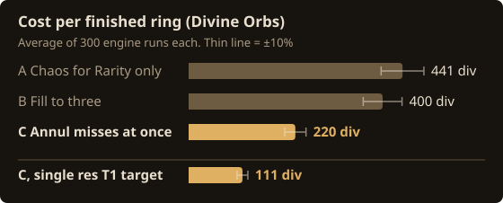
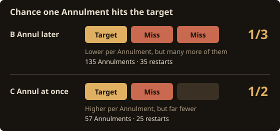
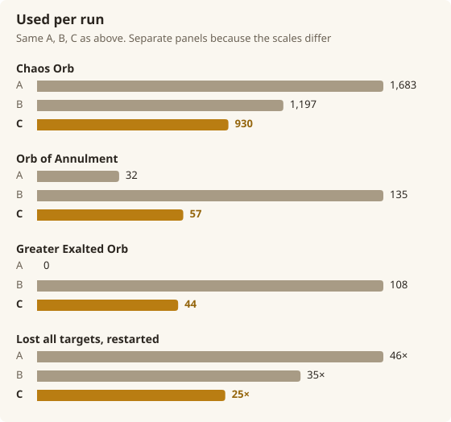

We had three groups of 300 crafters make the same Gold Ring. The only difference was one decision: what to do when a miss rolls. In this PoE2 ring suffix craft, the group that **annulled every miss on the spot** paid 220 Divine Orbs (div) per ring. The group that held misses until the suffixes were full paid 400.

An Orb of Annulment can take out a target you already have, so it feels right to annul as rarely as possible: keep adding Exalted Orbs until the slots are full, then clean up in one go. When we ran the craft hundreds of times on the ExileDesk engine, the opposite turned out to be true. This post walks through why, with charts.

:::summary What you'll learn
- Annulling a non-target suffix **the moment it rolls** is the cheapest method: 220 div per ring, about half of holding misses (400 div)
- The cost comes from how many Annulments you use, not how risky one Annulment is. Holding misses more than doubles the Annulments and adds restarts after losing every target
- Swapping the Rarity T1 target for a single resistance T1 brings the same method down to 111 div per ring
- All numbers are averages of 300 ExileDesk engine runs each (about ±10%)
:::

## The Ring and the One Decision We Changed

This is a familiar caster ring:

- A Rare Gold Ring, Item Level 82.
- A Fractured Spell Damage prefix (Glyphic, T2), plus one random mod. Chaos Orbs start from this two-mod item.
- Suffix targets only: increased Rarity of Items found (of Archaeology) T1, Cast Speed T2 or better, and all Elemental Resistances T2 or better. Any prefix is fine.

Once one target is on the ring, the rest are added with Exalted Orbs. Misses are removed with an Orb of Annulment (no Omen). If every target is gone, we go back to Chaos Orbs.

:::tip How the Exalted Orbs are used (same for all three groups)
- Cast Speed: a Skittering Catalyst brings Quality to 20%, then Omen of Catalysing Exaltation + Omen of Dextral Exaltation + Perfect Exalted Orb
- All Elemental Resistances: a Tul's Catalyst brings Quality to 20%, then the same Omens + Perfect Exalted Orb
- Rarity: there is no Catalyst for it, so it is aimed plainly with Omen of Dextral Exaltation + Greater Exalted Orb
:::

Up to here, all three methods are the same. The only difference is whether you annul a miss right away or wait until all three suffixes are full.

- **A**: Use only Chaos Orbs until Rarity T1 rolls. If Cast Speed or Resistances roll first, ignore them.
- **B**: Keep adding Exalted Orbs through misses until the suffixes are full, then annul.
- **C**: Annul as soon as any non-target suffix appears.

## Result: Annulling at Once Costs 220 div per Ring

| Method | Finished | Cost per ring | Chaos Orb | Annulment | Perfect Exalted | Greater Exalted | Lost all targets |
|---|---|---|---|---|---|---|---|
| A Chaos for Rarity only | 99.0% | 441 div | 1,683 | 32 | 34 | 0 | 46 times |
| B Fill to three | 99.7% | 400 div | 1,197 | 135 | 30 | 108 | 35 times |
| **C Annul misses at once** | **100%** | **220 div** | 930 | 57 | 15 | 44 | 25 times |

C costs about half of B. With 300 runs each, the average is within about ±10%, so the gap between B and C is well outside the noise. A and B barely overlap.

:::zundamon surprised
Wait, C annuls all the time and it's the cheapest? Annulment can delete your targets, so I thought using fewer was always better!
:::

:::metan normal
That's the trap. C annuls right away, but count the Annulments: A uses the fewest, then C. The one annulling the most is B, the method that waits.
:::

## Why Holding Misses Costs More

It comes down to how the Orb of Annulment works. Without an Omen, it removes one random non-Fractured mod. If the suffixes hold one target and two misses, there is a one-in-three chance of losing the target. With one target and one miss the chance is one in two, but you annul far less often.

Per Annulment, annulling early looks riskier. But what sets the cost is not how risky one Annulment is. It is how many you use.

B waits and then annuls, so it uses more Orbs of Annulment (135 per ring). Each one is another chance to hit a target you already have. Rarity T1 is also rare: Omen of Dextral Exaltation + Greater Exalted Orb lands it only 2.3% of the time. Adding Exalted Orbs while holding misses fills the slots with things you don't want. In the end, B lost every target and went back to Chaos Orbs 35 times per ring.

C annuls the moment a miss appears, so two misses never sit side by side. It used 57 Orbs of Annulment, and lost every target only 25 times. Perfect Exalted Orbs fell from 30 to 15, and Chaos Orbs from 1,197 to 930. Not hoarding misses made every line of the bill smaller.

A uses almost no Exalted Orbs. Instead it keeps spamming Chaos Orbs until Rarity rolls, so Chaos Orbs rise 1.4 times to 1,683 and the total ends up slightly above B.

:::tip When you craft it yourself
If a non-target suffix rolls, annul it before your next Exalted Orb. Don't wait to "fill one more slot first."
:::

### The First Roll Doesn't Matter

We also checked whether the first lucky roll matters. Splitting C's 300 runs by which target rolled first, or by the order the targets came together, every group averaged 210 to 245 div, all within the noise. After so many trips back to Chaos Orbs, the first roll's luck washes out.

## Swap One Target, Halve It Again: 111 div

Finally, we kept method C but replaced Rarity T1 with "any one of Fire, Cold or Lightning Resistance T1." Resistance T1 can also be weighted with a Tul's Catalyst and Omen of Catalysing Exaltation, and since any of the three elements will do, Chaos Orbs find it sooner. The result was 111 div per ring, exactly half of C. Almost all of the savings came from Chaos Orbs, down from 930 to 160.

:::metan happy
So insisting on Rarity is what makes this ring expensive. Deciding what you really need from the ring is the biggest saving of all.
:::

## Where the Numbers Come From

- Every number comes from the ExileDesk engine (the same one the website uses), applied one craft at a time. 300 runs per method, with a 2,000 div cap per run.
- Prices are the market prices collected by the ExileDesk server (2026-10-20 16:00 UTC, Forbidden Rites; 1 Divine Orb = 696.93 Exalted Orbs). The cost of fracturing is not included.
- Mod names and tiers were checked on poe2db. The Omen of Catalysing Exaltation multiplier follows Craft of Exile's formula.

:::note Not yet verified
These expected costs themselves have not been compared against Craft of Exile or in-game results. They are engine results.
:::

## Try It Yourself

You can [try the same Gold Ring on the crafting bench](/?base=Gold%20Ring). To compare costs while changing what you do after a miss, use ExileDesk's [Craft route tree](/?page=sim-tree&base=Gold%20Ring).

**Related posts**

- [PoE2 crafting expected cost](/en/blog/optimal-move-vs-intuition/)
- [PoE2 Gold Ring craft, step by step](/en/blog/gold-ring-video-decoded/)
- [PoE2 Cast Speed weight on poe2db](/en/blog/poe2db-cast-speed-weight/)
