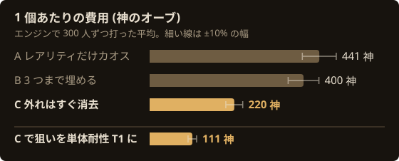
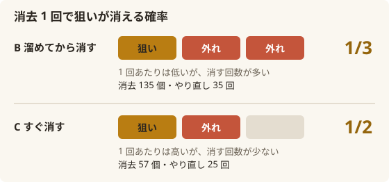
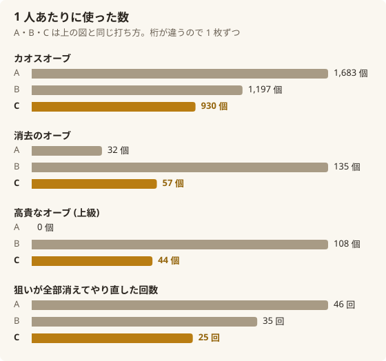

同じ金の指輪を、300 人ずつ 3 組に作らせてみました。違うのは「外れが付いた時の 1 手」だけ。それなのに PoE2 の指輪クラフトでサフィックス 3 つを揃える費用は、外れを**その場で消去した組**が 1 個 220 神、外れを溜めてから消した組は 400 神でした (神 = 神のオーブ、ディバイン)。

消去のオーブは、せっかく付いた狙いまで巻き込んで消すことがあります。だから「消す回数はなるべく減らしたい」「どうせなら枠が埋まるまで高貴を足して、まとめて消したい」と考えたくなります。ところが、エンジンで何百回も打ってみると結果は逆でした。この記事では、その理由を図で追いかけます。

:::summary この記事で分かる事
- 外れのサフィックスは**付いたその場で消去**するのが一番安い。1 個 220 神で、溜めてから消す打ち方 (400 神) のほぼ半額
- 高くなる原因は「消去 1 回の危なさ」ではなく「消去の回数」。溜めると消去が 2 倍以上に増え、狙いを失ってやり直す回数も増える
- 狙いのレアリティ T1 を単体耐性 T1 に替えると、同じ打ち方で 1 個 111 神まで下がる
- 数字は ExileDesk のエンジンで 300 人ずつ打った平均 (±10% ほど)
:::

## 作った指輪と、変えた 1 手

作ったのはキャスター向けの、よく見かける指輪です。

- 金の指輪、アイテムレベル 82 のレア。
- プレフィックスにスペルダメージ (グリフの、T2) がフラクチャー済み。そこにもう 1 つ乱数の MOD が付いた 2 MOD の形から、カオスオーブを打ち始めます。
- 狙いはサフィックスだけです。見つかるアイテムのレアリティ (考古学の) T1、キャストスピード T2 以上、全ての元素耐性 T2 以上。プレフィックスは何が付いても構いません。

狙いが 1 つ付いたら、残りは高貴なオーブで足していきます。外れたら消去のオーブ (お告げ無し) で消してやり直し、狙いが全部消えたらカオスからやり直します。

:::tip 高貴の打ち方 (3 組とも同じ)
- キャストスピード: 軽快のカタリストで品質を 20% にしてから、触媒の高貴のお告げ + 右側の高貴のお告げ + 高貴なオーブ (完全)
- 全耐性: トゥルのカタリストで品質を 20% にしてから、同じく触媒の高貴 + 右側の高貴 + 高貴なオーブ (完全)
- レアリティ: カタリストが無いので、右側の高貴のお告げ + 高貴なオーブ (上級) で素直に狙う
:::

ここまでは 3 組とも同じです。変えたのは「外れが付いた時に、すぐ消すか、3 つ埋まるまで待つか」の 1 か所だけです。

- **A**: レアリティ T1 が付くまでカオスだけを打つ。キャストスピードや全耐性が先に付いても使わずに流す。
- **B**: 外れが付いても、サフィックスが 3 つ埋まるまで高貴を足し続け、埋まってから消去する。
- **C**: 狙いでないサフィックスが 1 つでも付いたら、その場で消去する。

## 結果: 外れをすぐ消すと 1 個 220 神

| 打ち方 | 完成率 | 1 個あたり | カオス | 消去 | 高貴 (完全) | 高貴 (上級) | 狙いが全部消えた回数 |
|---|---|---|---|---|---|---|---|
| A レアリティだけカオス | 99.0% | 441 神 | 1,683 個 | 32 個 | 34 個 | 0 個 | 46 回 |
| B 3 つまで埋める | 99.7% | 400 神 | 1,197 個 | 135 個 | 30 個 | 108 個 | 35 回 |
| **C 外れはすぐ消去** | **100%** | **220 神** | 930 個 | 57 個 | 15 個 | 44 個 | 25 回 |

C は B のほぼ半額です。300 人ずつ回した平均の誤差は ±10% ほどで、B と C の差は誤差より十分に大きく、決着がついています。A と B の差は誤差の幅がぎりぎり重なる程度です。

:::zundamon surprised
え、消去をいっぱい打つ C が一番安いのだ? 消去は狙いも消しちゃうから、なるべく打たない方が得だと思ってたのだ。
:::

:::metan normal
そこが落とし穴なのよね。C は「すぐ消す」けど、消去の数で見ると一番少ないのは A、次が C。一番たくさん消しているのは、溜めてから消す B なの。
:::

## なぜ外れを溜めると高くなるのか

鍵は消去のオーブの性質です。消去のオーブ (お告げ無し) は、フラクチャー以外の MOD から等しく 1 つを消します。サフィックスに「狙い 1 つ + 外れ 2 つ」が並んでいれば、狙いが消える確率は 3 分の 1 です。「狙い 1 つ + 外れ 1 つ」なら 2 分の 1 ですが、消去の回数そのものが減ります。

1 回あたりで比べると、すぐ消す C の方が危なく見えます。でも、費用を決めるのは 1 回の危なさではなく、何回消すかでした。

B は外れを溜めてから消すので、消去の回数が増えます (1 人 135 個)。そのたびに、せっかく付いた狙いを巻き込む機会も増えます。さらにレアリティ T1 は、右側の高貴 + 上級で 1 回 2.3% しか付きません。外れを抱えたまま高貴を足すと、狙いでない物で枠が埋まっていきます。結果として、狙いが全部消えてカオスからやり直す回数が 1 人 35 回まで膨らみました。

C は外れが付いた瞬間に消すので、サフィックスに外れが 2 つ並ぶことがありません。消去は 57 個で済み、全部消えてやり直す回数も 25 回に減りました。高貴 (完全) は B の 30 個に対して 15 個、カオスも 1,197 個に対して 930 個です。外れを溜めないだけで、どの費目も小さくなっています。

A は高貴をほとんど使いません。その代わり、レアリティが付くまでカオスを打ち続けるので、カオスが 1.4 倍の 1,683 個に増えて B より少し高くなりました。

:::tip 実際に打つ時は
狙いでないサフィックスが付いたら、次の高貴を打つ前に消去する。「あと 1 つ埋めてから」と待たないのがコツです。
:::

### 最初に何が付いたかは効かない

もう 1 つ調べたのが、「最初に何が付いたか」で費用が変わるかです。C の 300 人を、最初に付いた狙いごと、最後に揃った順番ごとに分けて比べました。どの分け方でも平均は 210〜245 神で、差は誤差の中でした。何度もカオスに戻るうちに、最初の運は薄まってしまうようです。

## 狙いを替えると、さらに半分の 111 神

最後に、同じ C の打ち方のまま、レアリティ T1 を「火・冷気・雷のどれかの単体耐性 T1」に替えてみました。耐性 T1 もトゥルのカタリスト + 触媒の高貴で重く引けるうえ、3 つの元素のどれでもよいので、カオスで最初に付くのも速くなります。結果は 1 個 111 神、C のちょうど半分でした。減ったのはほとんどカオスで、930 個から 160 個になりました。

:::metan happy
レアリティにこだわるかどうかで、費用はここまで変わるのね。指輪に何を求めるか、先に決めておくのが一番の節約かも。
:::

## 数字の出どころと確かさ

- 数字は全部、ExileDesk のエンジン (Web 版と同じ物) で 1 手ずつ打った結果です。1 通り 300 人、1 人 2000 神で打ち止めにしています。
- 値段は ExileDesk のサーバーが取った相場 (2026-10-20 16:00 UTC、Forbidden Rites、1 神 = 高貴 696.93 個) です。フラクチャーまでの費用は入れていません。
- MOD の名前と段は poe2db で確かめました。触媒の高貴の倍率は Craft of Exile の式を使っています。

:::note 確かめていない所
この期待値そのものを Craft of Exile やゲーム内の実測と突き合わせてはいません。エンジンで打った結果です。
:::

## 自分で試す

同じ金の指輪は [クラフト台で打って](/?base=Gold%20Ring) 確かめられます。外れた時の手を変えながら費用を比べるなら、ExileDesk の [クラフトの道 (ツリー)](/?page=sim-tree&base=Gold%20Ring) で試せます。

**関連する記事**

- [PoE2 クラフトの期待値は勘と違う](/blog/optimal-move-vs-intuition/)
- [PoE2 金の指輪のクラフト手順](/blog/gold-ring-video-decoded/)
- [PoE2 キャストスピードの重みは poe2db で 1](/blog/poe2db-cast-speed-weight/)
